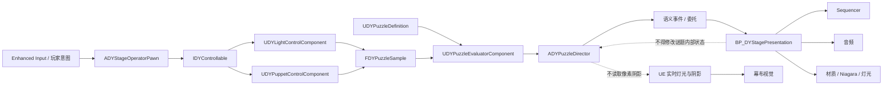
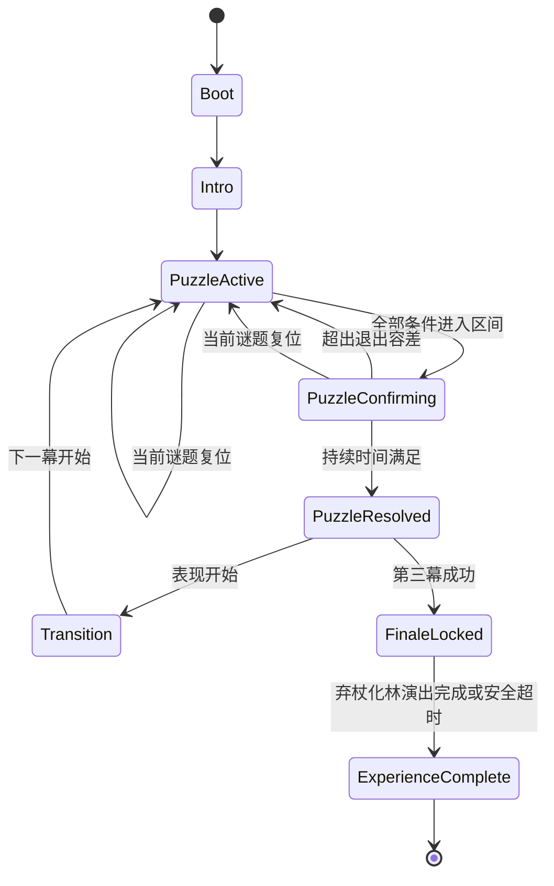

# 《灯影山海》开发架构设计

> 文档状态：基础架构 v1 已于 2026-10-01 获用户确认；实验项仍需在 `Dev/` 实测后再次确认  
> 适用版本：UE 5.8.x，Windows，C++ + Blueprint  
> 范围：一个戏台、三次核心互动、一个高潮结尾、5–8 分钟  
> 更新日期：2026-10-01

获准实验的控制变量、证据要求和决策流程见 `Docs/DEV_EXPERIMENT_PLAN.md`。

## 0. 不可绕过的架构与决策约束

> *永远不要以牺牲架构设计为代价追求功能；永远不要基于猜测进行权衡——必须与我确认。*

该约束的执行含义如下：

1. 新功能必须接入既有职责边界，不得为赶进度把核心状态、判定、演出和输入堆入 Level Blueprint。
2. 如果需求与现有架构冲突，先停止实现，列出冲突文件、受影响系统、可选方案、成本、风险与回退方式，再等待用户确认。
3. 如果资料不完整，不允许默认猜测玩家操作方式、视觉优先级、性能目标、许可条件或比赛展示方式。
4. 可以提出推荐方案，但“推荐”不等于“已批准”；未确认的权衡只能停留在文档、原型分支或 `Dev/` 测试资产中。
5. 不以“临时能跑”为理由复制核心判定逻辑。紧急降级也必须复用稳定接口，并记录技术债、影响和恢复方法。
6. 对纯粹机械、可逆且不改变行为的实现细节，可以在已确认的架构内执行；一旦存在体验、性能、维护性、许可或范围之间的权衡，必须向用户确认。

## 1. 架构目标

本架构只解决比赛 Demo 的必要问题：

- 三次互动复用同一套输入意图、参数采样、区间判定、持续确认和反馈系统。
- UE 真实光照与阴影负责玩家看到的画面；参数判定负责稳定通关，两者互不作为单点故障。
- C++ 保存事实、状态和规则；Blueprint/Sequencer 负责资产组装与演出。
- 每一层可以在独立测试关卡或纯逻辑测试中验证。
- 第三次互动成功必须直接触发“弃杖—落地—生根—成林”，不是通关后的装饰特效。
- Windows Development 与 Shipping 包中的行为一致；调试显示只在开发构建中出现。
- 不为赛后假设搭建通用任务系统、存档框架、联网框架或多关卡服务。

## 2. 总体依赖方向



依赖规则：

1. 输入层不知道谜题答案，只产生归一化控制意图。
2. 可控制 Actor 不知道当前是第几幕，只暴露稳定参数状态。
3. Evaluator 不播放动画、音效或镜头，只返回判定结果。
4. Director 不直接引用具体音效、材质、Niagara 或 Level Sequence。
5. Presentation 只消费“谜题开始、趋势变化、确认成功、高潮开始”等语义事件。
6. Sequencer 不直接改写谜题状态；演出结束只能通过带令牌的完成回调通知 Director。
7. Level Blueprint 不保存核心状态，不实现判定，不承担跨演出流程。

## 3. 保持单一游戏模块

20 天版本只保留一个游戏模块 `DengYingShanHai`，不为概念上的“整洁”拆出多个 UE 模块或插件。建议源码目录：

```text
Source/DengYingShanHai/
├─ Public/
│  ├─ Core/
│  ├─ Interaction/
│  ├─ Puzzles/
│  ├─ Presentation/
│  └─ Debug/
├─ Private/
│  ├─ Core/
│  ├─ Interaction/
│  ├─ Puzzles/
│  ├─ Presentation/
│  └─ Debug/
└─ Tests/
```

只有当项目真的出现第二个关卡、可独立发布插件或跨项目复用需求时，才讨论拆分模块；这属于架构权衡，必须先征得用户确认。

## 4. 运行时核心对象

### 4.1 `ADYStageGameMode`

唯一职责：

- 指定 Player Controller、Pawn 和默认 HUD；
- 发起整局重新开始；
- 处理无法恢复时返回标题界面的流程。

不负责谜题计分、第三幕演出、Actor 搜索或资产播放。

### 4.2 `ADYStagePlayerController`

职责：

- 为本地玩家添加和移除 Enhanced Input Mapping Context；
- 管理暂停、重新开始与输入模式；
- 把 UI/演出期间的输入锁定状态传给 Pawn。

具体按键绑定属于体验设计。当前架构只定义输入动作，不猜测最终按键，待用户确认后配置。

### 4.3 `ADYStageOperatorPawn`

职责：

- 保存玩家当前聚焦的可控对象；
- 把 Enhanced Input 转换成 `FDYControlIntent`；
- 调用 `IDYControllable`，而不是直接修改灯或皮影组件；
- 承载固定/受限演出相机所需的最小组件；
- 在控制模式变化时发出 UI 可消费的事件。

Pawn 不读取 `UDYPuzzleDefinition`，因此不能知道目标区间或替玩家吸附到答案。

### 4.4 `IDYControllable`

由可控制对象实现的 C++ `UINTERFACE`：

```text
CanBeginControl(Context)
BeginControl(Context)
ApplyControlIntent(Intent)
EndControl(Context)
SetControlEnabled(bEnabled)
GetControlSnapshot()
RestoreControlSnapshot(Snapshot)
```

接口只表达控制生命周期和状态快照，不包含具体输入键、不判断谜题成功。

### 4.5 `ADYLightRigActor` + `UDYLightControlComponent`

`ADYLightRigActor` 是场景中的灯具实体；Blueprint 子类负责灯架模型、灯光组件、音效和材质。`UDYLightControlComponent` 负责：

- 允许移动/旋转的轴；
- 世界空间约束转换为 0–1 归一化参数；
- 最大速度、加速度或阻尼；
- 控制启用状态；
- 初始快照与复位；
- 向调试层提供当前数值。

灯光强度、色温或阴影参数是否允许玩家操纵属于玩法权衡，目前不默认加入。

### 4.6 `ADYPuppetActor` + `UDYPuppetControlComponent`

`ADYPuppetActor` 表示幕后可见的夸父皮影装置；推荐使用同一骨架驱动的刚性分片 Skeletal Mesh。`UDYPuppetControlComponent` 负责：

- 平面内位置和受限朝向；
- 离散 `PoseId`；
- 姿态切换条件；
- 控制启用状态；
- 状态快照与复位；
- 参数采样。

视觉 Skeletal Mesh 与可选的 Shadow Caster Mesh 必须共享骨架和姿态。是否启用独立 Shadow Caster 必须在 `LV_ShadowLab` 实测后确认，不能基于猜测预设。

### 4.7 `UDYPuzzleDefinition`

使用 `UPrimaryDataAsset` 保存每幕可调数据，不保存运行时状态：

- `PuzzleId` 与显示名；
- 本幕开放的控制对象和参数通道；
- 每个参数的目标区间、进入容差和退出容差；
- 必需的 `PoseId`；
- 持续确认时长；
- 反馈阈值；
- 开始、接近、确认、完成等语义 Cue ID；
- 复位目标状态；
- 调试说明。

数据资产不得直接引用关卡 Actor。目标区间由编辑器配置，核心判定公式不能复制进 Blueprint。

### 4.8 `UDYPuzzleEvaluatorComponent`

纯规则组件，输入为 `FDYPuzzleSample` 和 `UDYPuzzleDefinition`，输出为 `FDYEvaluationResult`。职责：

- 区间和姿态条件检查；
- 归一化误差与趋势计算；
- 进入/退出容差形成迟滞，避免边界抖动；
- 连续满足时间累计；
- 短暂离开目标后的宽限处理；
- 生成调试用的逐参数结果。

Evaluator 不访问灯光渲染结果，不读取 Render Target，不调用 Sequencer，也不决定下一个谜题。

### 4.9 `ADYPuzzleDirector`

关卡中唯一的流程事实源，负责：

- 按已确认顺序激活三份 `UDYPuzzleDefinition`；
- 从灯和皮影控制组件获取 `FDYPuzzleSample`；
- 以固定、可配置频率调用 Evaluator；
- 保存体验状态、当前谜题、持续确认和完成状态；
- 开关对应控制通道；
- 广播语义事件；
- 处理当前谜题复位和整局复位；
- 第三幕确认成功后进入不可重复触发的高潮状态；
- 为演出完成回调设置超时降级，防止 Sequencer 中断导致流程卡死。

推荐把 Director 作为显式放置且可配置的 Actor，而不是 World Subsystem。原因是当前只有一个关卡，且它需要关卡内引用和编辑器可见配置。该选择属于架构提案，等待用户确认。

### 4.10 `IDYStagePresentationBridge` 与 `BP_DYStagePresentation`

C++ 只定义稳定的表现桥接口；Blueprint 实现负责：

- 播放 Level Sequence；
- 控制灯光、材质、Niagara、字幕与镜头；
- 调度锣鼓点、吟唱、风声、脚步与枝叶声；
- 在演出完成时带原始令牌回调 Director。

建议接口：

```text
PlayIntro(Token)
PlayPuzzleStart(PuzzleId, Token)
ApplyFeedback(PuzzleId, FeedbackState, Progress)
PlayPuzzleResolved(PuzzleId, Token)
PlayFinale(Token)
CancelActiveCue(Reason)
```

Presentation 可以改变外观，不能设置“谜题已完成”或修改目标参数。

## 5. 核心数据结构

### 5.1 `FDYControlIntent`

输入设备无关的意图：

- 控制通道；
- 归一化二维/一维输入值；
- 按下、持续、释放阶段；
- 帧时间；
- 来源玩家或控制上下文。

这样可以在不改变灯与皮影代码的情况下更换键鼠、手柄或展演设备绑定。

### 5.2 `FDYPuzzleSample`

只包含玩法需要的稳定参数，例如：

- 灯的归一化平移、距离、水平角和俯仰角；
- 皮影的归一化平面位置和朝向；
- 当前 `PoseId`；
- 样本时间戳；
- 数据有效标志。

不包含阴影贴图、屏幕像素或材质采样结果。

### 5.3 `FDYEvaluationResult`

- `FeedbackState`：未接近、方向错误、正在改善、进入区间、持续确认、丢失目标、成功；
- 总体进度；
- 是否全部进入通过区间；
- 已累计确认时长；
- 每个参数的误差、趋势和有效性；
- 失败/无效原因；
- 只触发一次的成功边沿。

进度只用于反馈，最终成功仍由必需条件和持续时间共同决定，避免“加权分够了但关键姿态错误”也能通关。

## 6. 体验状态机



状态约束：

- 只有 Director 能改变体验状态。
- `PuzzleResolved` 只在成功边沿进入一次。
- `FinaleLocked` 中锁定会破坏构图的控制输入，但仍允许暂停或整局重启。
- Presentation 回调必须匹配 Director 发出的 Token；过期回调直接忽略。
- 演出超时的具体时间值不能猜测，需要根据最终 Sequence 长度设置并由用户确认。

## 7. 三次互动共用一套系统

| 阶段 | 学习目标 | 开放参数 | 判定方式 | 演出结果 |
|---|---|---|---|---|
| 引日启幕 | 发现“灯移动会改变影子的方向与尺度” | 只开放少量灯光控制通道，皮影固定 | 相同 Evaluator 的少参数配置 | 幕布从静止进入可读状态，建立规则 |
| 逐光成形 | 学会灯与皮影必须协同 | 灯 + 皮影位置/朝向 | 同一套参数区间、迟滞和持续确认 | 夸父影形完整，追日节奏推进 |
| 杖落成林 | 综合运用此前规则 | 灯 + 皮影位置/朝向 + 指定姿态 | 同一 Evaluator 的完整配置 | 成功直接触发弃杖、落地、生根、成林 |

三幕不能各自创建独立判定 Blueprint。差异只来自 `UDYPuzzleDefinition`、可用控制通道和表现 Cue。

## 8. “杖落成林”的直接因果链

第三幕的成功链必须明确可验证：

```text
参数全部满足
→ 持续确认完成
→ Director 锁定第三幕成功（仅一次）
→ 禁用会破坏画面的灯/皮影输入
→ Presentation 播放夸父力竭与弃杖动作
→ 杖落地事件触发冲击声和落点反馈
→ 同一落点开始根系/枝干生长
→ 林影向幕布与幕外空间扩展
→ 风声、枝叶声和锣鼓收束
→ 演出完成回调
→ ExperienceComplete
```

“成林”不得由通关后独立计时器随意播放；必须持有第三幕成功 Token，并由“杖落地”演出节点触发。若演出资产缺失，降级方案仍应从落杖点播放简化材质扩散和林影，不改变因果顺序。

## 9. 视觉阴影与玩法判定分离

### 视觉层

- 使用 UE 5.8 的实时灯光、阴影、幕布材质和皮影几何；
- 主灯可移动，最终阴影方案在 `LV_ShadowLab` 中比较；
- 可以使用同骨架 Shadow Caster 提升稳定性，但不能让玩家看到重复模型；
- 视觉异常可以触发表现告警或回退材质，但不得破坏判定状态。

### 判定层

- 只读取可控对象的标准化变换、姿态和时间；
- 使用进入/退出两个容差区间防止边界抖动；
- 使用持续确认防止偶然掠过目标；
- 反馈进度与成功条件分开；
- 低分辨率 Mask 对比仅是赛后或后期可替换实验，不进入主路径，除非用户明确批准。

## 10. Blueprint 与 Sequencer 约束

Blueprint 可以：

- 组装 Actor 组件和替换美术资产；
- 设置 Data Asset、范围、容差和演出引用；
- 响应 C++ 语义事件；
- 播放声音、材质变化、Niagara 与 Sequencer；
- 完成镜头、字幕和节奏微调。

Blueprint 不可以：

- 复制一份 C++ 区间判定；
- 使用 Tick 每帧遍历 Actor 查找依赖；
- 使用 `Get All Actors of Class` 维持运行时核心引用；
- 通过硬编码延时决定谜题已完成；
- 在 Level Blueprint 保存当前幕次或成功状态；
- 让 Sequencer Event Track 直接写 Director 私有状态；
- 通过 Cast 链跨越多层依赖。

推荐通信顺序为“编辑器显式引用 → C++ 接口 → 委托/事件”；是否引入 Subsystem、Gameplay Tags 或第三方事件总线必须先确认。

## 11. 引用与生命周期

- 关卡必需 Actor 通过 `UPROPERTY(EditInstanceOnly)` 显式配置，由 Director 在 `BeginPlay` 验证。
- 必需引用缺失时在 Development 构建输出明确错误并阻止开始，不允许静默猜测替代 Actor。
- C++ UObject 引用使用 `TObjectPtr`；非拥有的临时引用按生命周期使用 `TWeakObjectPtr`。
- Data Asset 保存配置，不保存运行时 Actor 指针。
- Blueprint 的表现资源可通过软引用按 Cue 加载；是否需要异步加载要以实测卡顿和包体数据决定，不能预先复杂化。
- 所有动态委托在明确生命周期中绑定和解绑，避免关卡重启后重复响应。

## 12. 复位、失败与降级

### 当前谜题复位

1. Director 停止采样；
2. 取消活动 Cue；
3. 清除确认计时和成功边沿；
4. 从 Puzzle Definition 恢复灯和皮影快照；
5. Presentation 恢复本幕视觉基线；
6. 重新启用允许的控制通道；
7. 恢复采样。

### 整局重新开始

由 GameMode 发起明确的关卡重载或完整状态重建。两种方式的取舍涉及加载时间、引用安全与实现成本，必须实测后由用户确认。

### 安全降级

- Sequence 未回调：Director 在已确认的超时后记录错误并进入最小可完成演出。
- 音频缺失：不阻塞交互，仅记录资产验证错误。
- Niagara 缺失：使用材质或可见性切换的简化效果。
- 视觉阴影暂时失真：参数判定继续工作，调试层提示视觉与逻辑可能不一致。
- 关键 Director/Definition/控制对象缺失：禁止进入正式流程，避免产生不可复现状态。

## 13. 调试与过程证据

Development 构建提供可开关的调试显示：

- 当前体验状态与 Puzzle ID；
- 每个参数的当前值、目标区间、进入/退出容差；
- 参数趋势和总体反馈状态；
- 持续确认计时；
- 灯与皮影的控制边界；
- 当前 Presentation Token 和超时状态；
- 视觉 Shadow Caster 是否启用；
- 当前帧率、Game Thread、GPU 与关键阴影开销。

Shipping 构建必须通过编译条件或配置关闭调试绘制和开发 Widget。每个里程碑保留：

- 灰盒录屏；
- 调试界面截图；
- 三幕参数配置快照；
- 性能记录；
- Development/Shipping 打包记录；
- 盲测问题与调整结论；
- 第三方许可和 AI 使用记录。

## 14. 测试架构

### 纯逻辑自动化测试

优先覆盖：

- 区间边界包含关系；
- 环绕角度比较；
- 进入/退出迟滞；
- 确认计时与短暂离开；
- 无效样本不会成功；
- 成功边沿只触发一次；
- 复位后计时与状态归零；
- 第三幕成功只能进入一次 Finale。

### 测试关卡

```text
Content/DengYingShanHai/Dev/
├─ Interaction/LV_InteractionLab
├─ Puzzles/LV_PuzzleLab
├─ ShadowLab/LV_ShadowLab
└─ ArtReview/LV_ArtReview
```

- `LV_InteractionLab`：只验证输入、控制约束和复位。
- `LV_PuzzleLab`：用基础体和数值面板验证三份 Data Asset。
- `LV_ShadowLab`：只比较幕布材质、实际阴影和 Shadow Caster。
- `LV_ArtReview`：比较免费/开源资产、主材质、镜头和性能。

正式关卡只有在上述测试通过后接入对应功能。

## 15. 性能策略

- 玩法判定不需要每帧执行；建议从 10–20 Hz 区间实测，最终频率等待用户根据手感和性能确认。
- 控制组件只在被操纵或需要采样时更新，避免常驻 Tick。
- 不在 Tick 中分配大量临时数组、扫描场景或加载资源。
- 限制投射高质量动态阴影的灯光数量；皮影主灯拥有最高优先级。
- 透明幕布、双层幕布和独立 Shadow Caster 都必须用 GPU Profile 实测，不凭视觉猜测成本。
- 硬件光追不能成为最低运行要求；是否作为高画质档需在目标电脑测试后确认。

## 16. 内容目录与 Blueprint 资产

```text
Content/DengYingShanHai/
├─ Core/
│  ├─ Data/DA_DYPuzzle_01_IntroSun
│  ├─ Data/DA_DYPuzzle_02_ChaseForm
│  └─ Data/DA_DYPuzzle_03_StaffForest
├─ Characters/BP_DYStageOperator
├─ Puppets/BP_DYKuafuPuppet
├─ Stage/BP_DYStagePresentation
├─ Puzzles/BP_DYPuzzleDirector
├─ Lighting/BP_DYLightRig
├─ Cinematics/
│  ├─ LS_DY_Intro
│  ├─ LS_DY_Transition_01_02
│  ├─ LS_DY_Transition_02_03
│  └─ LS_DY_Finale_StaffForest
├─ UI/WBP_DYHUD
├─ Audio/
├─ VFX/
├─ Maps/LV_DengYingShanHai
└─ Dev/
```

名称是提案；一旦用户确认并开始建资产，不随意重命名以避免重定向器和引用风险。

## 17. 单人制作责任人

用户本人是唯一人类作者，负责技术、数据、资产适配、Blueprint、声音、动画、视频、许可和最终提交。Codex 按本轮授权辅助实现与验收，不作为制作成员。不存在第二名美术或视频制作人员。

资产按已确认规格筛选免费合规资源、定向适配并技术验收；不要求作者从零手工建模。原始来源、许可、适配过程和真实个人贡献单独记录。每轮只设一个工具执行者，不并行改写同一文件。

## 18. 架构决策与实验授权

基础架构已经获得用户确认；阴影、幕布和整局复位仍只获得 `Dev/` 实验授权。判定频率与 PC 键鼠基线已在 M1 人工验收后确认，但 `Dev/` 目标值和视觉参数不得自动进入正式关卡：

| ID | 决策 | 推荐方案 | 主要理由 | 未确认前允许做什么 |
|---|---|---|---|---|
| ADR-001 | 流程事实源 | 关卡显式放置 `ADYPuzzleDirector` Actor | 单关卡、引用透明、编辑器可验证，比 Subsystem 更小 | **Accepted：允许进入基础实现** |
| ADR-002 | 输入组织 | Pawn 生成设备无关 Intent，控制对象实现接口 | 后续换键鼠/手柄不改谜题 | **Accepted：只实现设备无关层，不猜测按键** |
| ADR-003 | 皮影实现 | 刚性分片 Skeletal Mesh，共享骨架 | 比多个父子 StaticMeshActor 更稳定、易动画 | **Accepted：允许建立结构与枢轴测试** |
| ADR-004 | 阴影实现 | 先测试视觉 Mesh；不稳定时再启用同骨架 Shadow Caster | 保持真实阴影并控制重复几何成本 | **Dev 实验已授权；正式方案待二次确认** |
| ADR-005 | 幕布实现 | Masked/近似不透明承影层为稳定基线，薄 Translucent 只做视觉叠层候选 | 降低透明排序与动态阴影不稳定 | **Dev 实验已授权；正式方案待二次确认** |
| ADR-006 | 判定频率 | 15 Hz 统一逻辑采样，Holding 使用真实世界时间 | 10/15/20 Hz 测试均通过，用户确认 15 Hz 的操作响应 | **Accepted：竞赛版本基线** |
| ADR-007 | 谜题流程 | Data Asset + Evaluator + Director，共用三幕 | 避免三套 Blueprint 逻辑 | **Accepted：允许进入基础实现** |
| ADR-008 | 演出桥 | Token 化异步完成回调 + 超时降级 | 防重复回调和流程卡死 | **Accepted：允许进入基础实现** |
| ADR-009 | 整局复位 | 实测“关卡重载”与“原地状态重建”后确认 | 二者在加载时间和可靠性上有权衡 | **Dev 实验已授权；正式方案待二次确认** |
| ADR-010 | 玩家按键/控制切换 | PC 键鼠 `E` 进入/退出、`A/D` 操纵当前对象、`R` 情境复位 | 用户完成 PIE 检查并确认映射无问题；语义 Action 仍可重映射 | **Accepted：当前竞赛版本 PC 基线** |
| ADR-011 | Level Blueprint 边界 | 不承担核心流程、判定和运行时事实 | 保持依赖清晰并避免关卡脚本成为单点故障 | **Accepted：允许作为硬边界执行** |

确认结果同步记录在 `Docs/ARCHITECTURE_DECISIONS.md`。所有实验必须保存对比证据；只有用户确认实验结论后，才能将对应状态改为 `Accepted` 并接入正式关卡。

## 19. 首个架构里程碑的验收条件

该里程碑不包含正式美术；基础架构已获准开始，但只能在确认真实项目结构后实施，实验内容必须留在 `Dev/`：

1. `LV_PuzzleLab` 中使用基础体运行三份 Puzzle Definition；
2. 三幕使用同一个 Evaluator 和 Director；
3. 调试面板能显示所有目标区间、趋势、确认计时和状态；
4. 修改真实灯光/阴影不会改变逻辑判定；
5. Puzzle 1 只开放基础灯光参数；Puzzle 2 开放灯与皮影协同；Puzzle 3 增加姿态综合条件；
6. 第三幕成功只触发一次模拟“落杖—成林”语义事件；
7. 当前谜题复位至少连续验证 10 次，无重复委托和残留计时；
8. 至少有一组区间、迟滞、持续确认的自动化测试通过；
9. Development 包可完成全流程；
10. 提交一份测试结果、风险和下一步待确认事项。

在满足这些条件前，不把正式场景资产接到核心流程中，也不以增加功能掩盖架构缺口。
