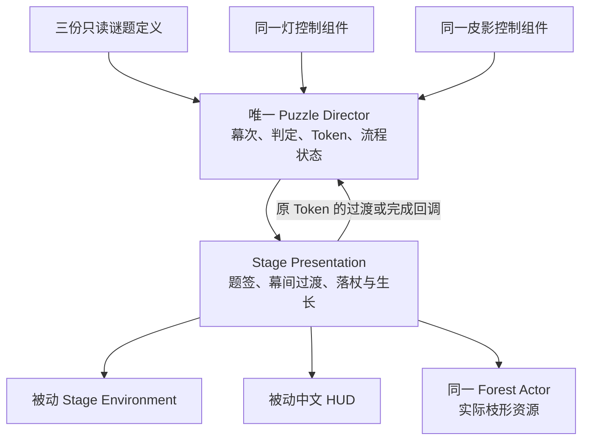

# 最小三幕连续 Dev 版接入方案

日期：2026-10-09。状态：用户已确认本页整套 Dev 串联规则；阶段 A 原生接入、编译及回归通过；阶段 B 新地图、6 个专属资产、逐幕提示及可见连续测试通过；独立 Development 包构建、实际入口画面和正常退出通过。打包版三幕真人键鼠操作未代勾。当前唯一实施者与验收负责人：Codex，依据用户要求直接完成后续任务；队友继续负责正式美术与视频。

## 1. 本次已确认与下一步目标

用户在观看第三幕自动测试后回复：“没有问题，进入下一步”。登记为本次可见自动测试及继续开发的确认：两次真实落杖成林、一次完成态复位、中文步骤和数值显示可接受。该回复没有逐项描述实体 E/A/D/R，也没有把 Dev 秒数、美术或正式结尾定稿。

下一步制作一份独立三幕连续灰盒：同一张地图、同一个 Director、同一盏主灯、同一个皮影与同一块幕。流程依次为 **引日启幕 → 逐光成形 → 杖落成林**。第三幕仍从玩家最终构图连续落杖，真实 A 端接触 Z70 地线后，才从同一接触点生长原有 15 枝。

此次先让三幕连续可玩和可验证，不设置正式 5–8 分钟演出节奏。现有 M1/M2/M3 单幕、自动观察入口及包都保留，便于回归和比较。

## 2. 需要确认的具体 Dev 体验建议

推荐以下一组完整行为：

1. **前两幕成功后，成功题签停留 2 秒，再自动进入下一幕。** 这 2 秒仅为本轮 Dev 过渡候选。过渡由表现层安排，完成时带当前 Token 回调，由 Director 推进。
2. **进入下一幕时，灯与偶回到已有 `.15/.15` 待演基线，然后开放该幕控制。** 幕间题签交代“下一幕，重新建立灯偶关系”。不增加按键，不改变谜题目标。成功过渡期间仍可使用已有的情境 R 取消并重试当前幕。
3. **第三幕成功后，等待真实落杖、接触及林影完整生长，才显示“复演已成”。** 完成后保持林影和画面，不自动退出，不在逻辑 Resolve 时提前显示全部完成。
4. **本轮 R 沿用当前幕复位。** 探索 R 仍只复位玩家；仍在操纵时的 R 只重试当前幕，不回退已完成前幕。第三幕落杖、生长或完成后仍操纵时可重试第三幕。整段从第一幕重演，本轮先通过正常关闭并重新打开独立入口完成。

这些规则会改变连续版本的幕间体验，因此按 AGENTS.md §5 “永远不要基于猜测进行权衡——必须与我确认”先确认，再接入。用户已经回复“采用这套 Dev 串联规则（推荐）”。正式 R/Skip/全局重启、菜单、输入锁策略和正式演出时长仍另行设计。

### 为什么不能直接保留第二幕数值进入第三幕

以下作者配置已在 `ColdNativeProbe-Run1` 中通过新 UE 进程冷读保存资产，实值相符，未保存资产。

| 幕 | 灯目标 | 偶目标 | 进入 / 退出容差 | 姿态 | 保持 |
|---|---:|---:|---|---|---:|
| P01 引日启幕 | .68 | 不启用偶位条件 | 灯 .045 / .085 | 不启用姿态条件，偶不可操纵 | 1.25 s |
| P02 逐光成形 | .72 | .80 | 两项 .05 / .09 | P02_StrideReach | 1.25 s |
| P03 杖落成林 | .72 | .85 | 两项 .05 / .09 | P02_StrideReach | 1.25 s |

P02 的中心答案 `.72/.80` 与 P03 只差偶位 `.05`，正好落在 P03 进入容差的包含边界；两幕姿态相同。Evaluator 使用 `AbsoluteError <= ActiveTolerance + UE_DOUBLE_SMALL_NUMBER`。因此直接切 Definition 并保留数值，会存在 P03 不经新操作就开始保持、随后自动成功的情况，削弱“综合运用”。

回到现有基线是当前最小 Dev 方案。另一条路线是重新校准不重叠的逐幕目标，适合后续正式构图，但需要新的几何样本与参数确认，不能在本轮静默改动已确认候选。

## 3. 单一权威与依赖

`TECH_SPEC.md:183–198` 与 `ARCHITECTURE_DESIGN.md:199` 已明确 Director 保存三幕顺序、状态并独自推进。沿用该架构，不增加第二个保存幕次或决定结束的 Flow Actor。

- Director：三份定义的显式引用、当前幕、体验阶段、当前成功身份；无世界扫描，不读阴影像素。
- Evaluator：继续负责同一套参数区间和世界时间保持，不决定下一幕。
- Presentation：消费事实，执行过渡与现有 P03 Timeline；只持表现会话和当前 Token，不维护第二份完成进度。
- Environment：接受 Presentation 的语义状态，不读 Director，不控制流程，不 Tick 扫描。
- HUD：显示幕名、反馈与 Dev 结束文字，不读取目标/容差，不参与判定。
- GameMode / PlayerController：沿用当前显式注册与 POV/输入所有权。

所有状态随本世界销毁；没有跨地图持久化、联网或存档。

## 4. 已核实的接入缺口

1. 当前 Director 只有一份 `PuzzleDefinition`，没有队列、切幕或演出完成接口。新增有序三份引用与运行态；旧单定义模式默认继续工作。
2. 不能在 `OnPuzzleResolved.Broadcast` 的同步调用栈直接切下一幕。Presentation 仍在该栈读取当前快照；必须等过渡回调，并核对当前幕、当前 Token、阶段及一次消费。每个外部回调后重新检查重入/销毁状态。
3. 原生 `CaptureResolvedStaffPresentation` 没有最终幕门控。三幕模式下增加明确最终幕 eligibility；P01/P02 不捕获落杖会话。原单幕 M3 保留既有 opt-in 行为。
4. M3 作者图有准确的 `P03_DevPlayableCandidate` ID 门控；新三幕 Presentation 保留该 ID 并冷读核查。不能仅凭旧脚本声称当前 `.uasset` 执行图已经通过。
5. `CompleteGrowth` 当前只设置本地 `Completed` 和字幕，没有 Director 完成通知。新接口在当前真实接触、有效林会话及最终生长样本成立后，才发出一次带 Token 的完成回调。
6. 完成回调不能让成功 Token 失效。完成后需保留快照和 Forest；只消费“本次回调许可”，明确 R 重试或 World teardown 时才失效和清理。
7. 原 Presentation 每次激活都 `ResetToDormant`，每次成功套同一个环境状态。三幕模式必须按当前幕恢复入幕环境，避免进入 P02/P03 熄灭前幕成果。现有 Environment 只有前三态，本轮先映射 Dormant、SunAwakened、ChaseAwakened，不宣称正式五态已经完成。
8. 原 Widget `ActTitle` 是默认配置，普通运行中不会切幕名。增加仅传递幕名/阶段的表现通道和实例更新，保留现有中文字体、被动 HUD 和默认行为。

## 5. 最小接入合同与实际接口

Director 对 Blueprint 只提供只读幕次/阶段快照。实际原生过渡与完成入口为私有 `AcceptActTransition(Presentation, Token)` 和 `AcceptFinaleCompletion(Presentation, Token)`，只接受本世界显式登记的 Presentation；冷读已证明它们未向 Python/Blueprint 导出。任意索引切定义保持私有，不提供可绕过顺序的通用 SetDefinition 节点。Blueprint 的最终表现回调仅调用 Presentation 的 `SubmitForestFinaleCompletion(Token)`；该原生入口先验证真实接触、当前资源会话及全部实际枝组件完整状态，再向 Director 提交通知，不允许仅凭成功 Token 宣告演出完成。

建议 Dev 体验状态为 `Inactive → Playing → AwaitingTransition → Playing`；最终幕 `Playing → AwaitingFinale → Complete`。Evaluator 自己的 Searching/Holding/Resolved 状态继续独立。当前幕 R 清除该幕旧身份和过渡许可，保留前幕进度；迟到旧回调不能再次推进。

Presentation 完成过渡只提交通知，Director 校验并激活下一幕。P03 原生接触和 Forest 资源预检保持现有严格精度；完整生长回调提交前再次核查真实会话。UI 的“复演已成”仅在 Director 接受最终回调后显示。

## 6. 文件与资产白名单、回退

阶段 A：

- 修改 `Source/DengYingShanHai/Public/Puzzles/DYPuzzleDirector.h` 与对应 Private `.cpp`。
- 新增 `Public/Puzzles/DYActSequenceTypes.h` 与 `Private/Tests/DYActSequenceAutomationTests.cpp`。
- 增加明确最终幕/完成通知合同：`Public/Stage/DYStagePresentation.h` 与对应 Private `.cpp`。
- 增加实例题签/阶段通道：`Public/UI/DYInteractionHUDWidget.h`、对应 Private `.cpp`，以及 `Public/UI/DYInteractionHUD.h`、对应 Private `.cpp`；以审查后的最小需要为准，不绕过原被动 HUD 适配器。

阶段 B：新建 `/Game/DengYingShanHai/Dev/ThreeAct/`，从当前 M3 Runtime 地图复制出 `Maps/LV_ThreeActDev`；新增专属 Stage/UI/GameMode 变体，硬引用原三份 Definition、已登记中文字体与 Forest BP。只移除新地图副本中已确认的几何诊断实例。新作者脚本与新启动入口命名为 `Create-ThreeActDev.py`、`Start-ThreeActDev.ps1/.cmd`；旧创建脚本不重跑、不覆盖。

资产来源：

- P01 `/Game/DengYingShanHai/Dev/M1/Data/DA_DY_P01_SunAwakening`
- P02 `/Game/DengYingShanHai/Dev/M2/Data/DA_DY_P02_ChaseForm`
- P03 `/Game/DengYingShanHai/Dev/M3/Runtime/DA_P03RuntimeCandidate`
- Forest `/Game/DengYingShanHai/Dev/M3/Forest/BP_DYForestPresentation_Dev`
- 字体 `/Game/DengYingShanHai/Dev/M2/UI/FF_DYSourceHanSansSC_Font`

大改前保存源码前镜像、白名单哈希和 Git 只读状态，保留用户未提交改动。旧地图、旧 `.uasset`、旧启动器、现有 Config 和原包保持不变。回退采用本轮前镜像及单独旧入口；不使用 reset/clean，不删除用户文件。

## 7. 验收与打包

先验证原有测试与默认单幕行为，再验证三幕按序、旧/重复/跨实例回调拒绝、事件重入、P01/P02 无落杖/Forest、幕间不会自动解下一幕、当前幕复位、第三幕真实接触后生长、完成后保留当前 Token/林影、EndPlay 不复活流程及晚到 HUD 幕名正确。

随后在新 Dev 地图做可见自动过程与实际 E/A/D/R 三幕操作。自动结果与真人报告分开留存。最后生成独立 Windows Development 包，Cook 根仅为 `LV_ThreeActDev`，核查依赖清单；不用 cookall 或整个 Dev 树 AlwaysCook，不覆盖原包。Shipping 入口需在隔离构建配置中明确起始地图，不能依赖其命令行地图参数。

本轮方案准备证据：`D:\灯影山海\Saved\Audit-2026-10-09-ThreeActPreparation\`。实施及验证证据：`D:\灯影山海\Saved\Audit-2026-10-09-ThreeActIntegration\`。实际分阶段结果见 `Docs/THREE_ACT_DEV_VALIDATION.md`：104 项原生回归和 24 项保存地图可见检查通过，测试实际退出 0；Run3 独立 Windows Development 包构建成功，实际入口画面和正常退出通过。新入口为 `D:\灯影山海\Start-ThreeActDev.cmd`，明确选择该包与新地图。实体 E/A/D/R、打包版三幕全流程及正式完成标准分别验收，不用脚本演示替代真人操作结论。
