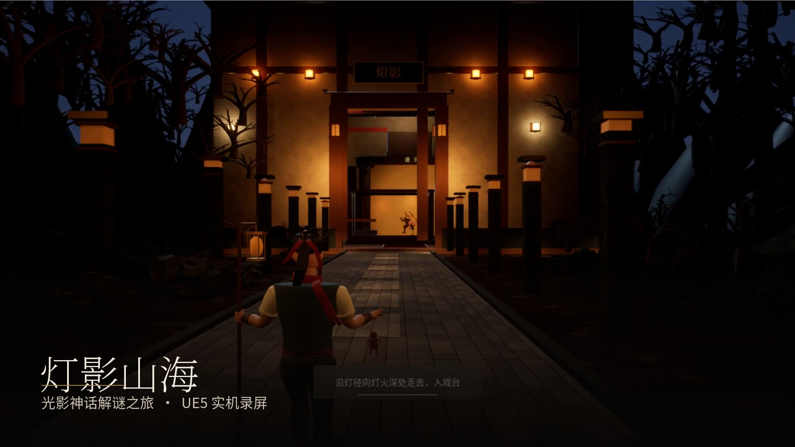
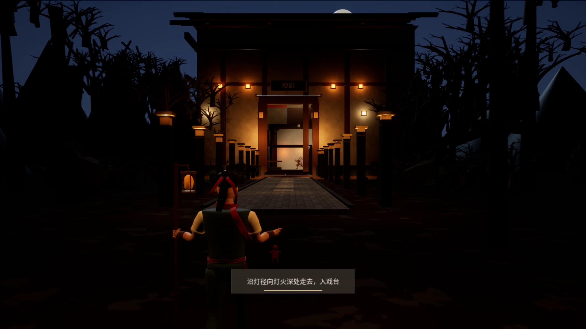
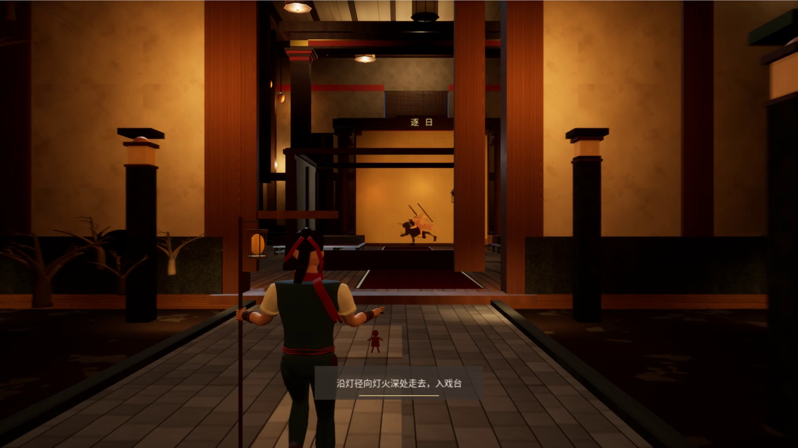
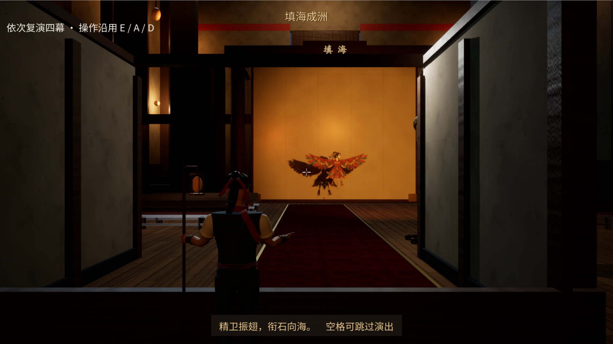
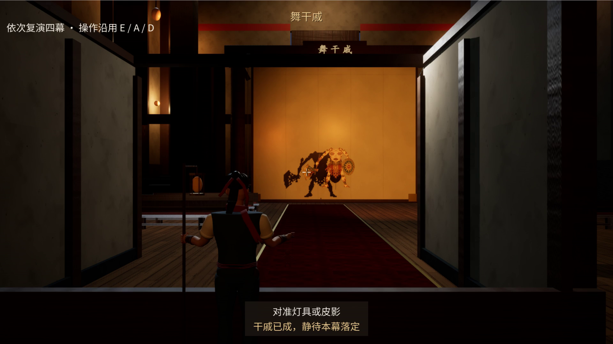
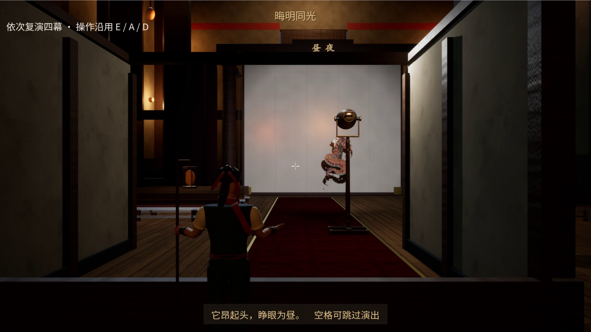
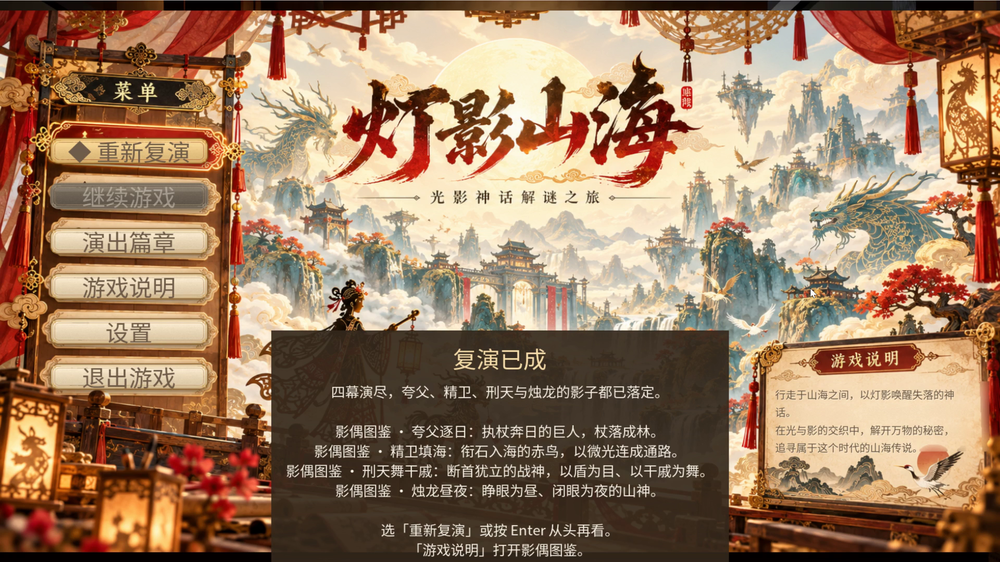

# 灯影山海 · DengYingShanHai

> 一座久未开演的影戏台，最后一出《逐日》停在夸父尚未落杖的时刻。
> 玩家作为「复演者」重演这出戏——**以灯为日，以影为夸父**。

**Unreal Engine 5.8 实时光影交互叙事 Demo** · Windows · 5–8 分钟 · 单地图 · C++ + Blueprint



---

## 这是什么

《灯影山海》把中国皮影戏的「灯—偶—幕」关系做成可玩的解谜核心：玩家不直接操纵影子，而是移动**灯**、挪动**皮影**，让幕布上的实时投影满足目标图形。视觉上的影子由 UE 实时灯光与阴影生成，判定则由独立的参数区间完成——**视觉阴影与玩法判定分离**，既保证画面真实，也保证交互稳定可测。

四幕结构（可连续演完，也可从菜单「演出篇章」单幕进入）：

| 幕 | 幕名 | 玩家要做的事 |
| --- | --- | --- |
| 第一幕 | 夸父逐日 | 以灯为日，把杖影送入幕上缺口 |
| 第二幕 | 精卫填海 | 灯与偶协同，让翼影落进海面缺口 |
| 第三幕 | 刑天舞干戚 | 综合运用已学操作，对齐干戚投影 |
| 第四幕 | 烛龙昼夜 | 昼夜切换，用两种光位分别解开机关，落杖成林 |

三次互动的学习曲线固定为「发现规律 → 协同控制 → 综合运用」；第四幕只组合已学能力，不新增输入语法。「弃杖化林」的高潮从玩家最后一次互动的落杖点直接生长，不切镜、不黑屏跳转。

## 画面

| | |
| --- | --- |
|  |  |
|  |  |
|  |  |

九张 1920×1080 实机截图与总览见 [Screenshots/Gameplay-Run167/](Screenshots/Gameplay-Run167/)。

## 评审片

[Video/Review-20261023/03_final/DY_Review_Silent_1080p60.mp4](Video/Review-20261023/03_final/DY_Review_Silent_1080p60.mp4) — 静音版，196 秒，1920×1080@60，全部素材来自游戏实机录屏，无旁白、无片尾字幕；章节卡与压暗带由 ffmpeg + PIL 生成，脚本见 [Video/Review-20261023/02_tools/](Video/Review-20261023/02_tools/)。

## 仓库结构

```text
DengYingShanHai.uproject      UE 工程入口（UE 5.8.3）
Source/                       C++ 源码：谜题判定、Puzzle Director、灯光/皮影、HUD、音频演出
Config/                       引擎与游戏配置（默认地图、渲染、输入）
Content/DengYingShanHai/
├─ Maps/                      正式主地图 L_DY_Main
├─ Puppets/                   三具影偶（精卫 / 刑天 / 烛龙）：网格、骨骼、材质、姿态
├─ Stage/                     戏台结构、影窗、灯具、观众席
├─ UI/                        菜单、题签、图鉴、结束面板
└─ Core/                      GameMode、输入、通用蓝图
                               （Dev/ 实验关卡留本地，不入库）
Assets/Sources/               美术管线脚本、清单与验证记录（大体积源文件不入库）
Scripts/                      构建、启动、环境检查与资产生成脚本
Docs/                         设计、技术、验证、许可与交付文档
Screenshots/                  实机截图
Video/                        评审片成片、分段脚本与质检结果
Tools/                        辅助工具
```

## 快速开始

**环境基线**：Unreal Engine 5.8.3 · Visual Studio 2026 · Windows SDK 10.0.26100 · Git LFS

> 本仓库沿用既有入库范围，未包含 `Dev/` 中的部分正式依赖。克隆后需先补齐这些本地资源；以下步骤适用于资源齐全的本地工程。仓库不包含可直接启动的打包游戏。

```powershell
# 1. 环境自检（Required failures 必须为 0）
powershell -ExecutionPolicy Bypass -File .\Scripts\Check-Environment.ps1

# 2. 编译 Editor Target
& 'C:\Program Files\Epic Games\UE_5.8\Engine\Build\BatchFiles\Build.bat' `
  DengYingShanHaiEditor Win64 Development `
  '-Project=<ProjectRoot>\DengYingShanHai.uproject' `
  -WaitMutex -NoHotReloadFromIDE -NoEngineChanges

# 3. 打开工程
#    <ProjectRoot>\DengYingShanHai.uproject
```

> 路径提示：UE 的 UBT 对中文路径敏感，建议用英文联结（junction）指向工程根目录，例如
> `mklink /J C:\UEProjects\DengYingShanHai "D:\灯影山海"`，再用英文路径打开与编译。

**运行已打包版本**（发布包体积 500 MB 以上，按仓库策略不入库，需本地构建）：

```text
Builds/FormalMain-Shipping-<日期>-Run<n>/Windows/DengYingShanHai.exe
```

或双击根目录 `Start-ReleaseEntry-Shipping.cmd`，它通过 `Scripts/Start-FormalShipping.ps1` 校验包身份（主地图 SHA256、原生 EXE SHA256、文件数与字节数）后再启动。

## 文档导航

| 想了解 | 看这里 |
| --- | --- |
| 玩法、四幕流程、文化母题 | [Docs/GDD.md](Docs/GDD.md) |
| C++/Blueprint 架构与判定方案 | [Docs/TECH_SPEC.md](Docs/TECH_SPEC.md) |
| 架构决策与回退记录 | [Docs/ARCHITECTURE_DECISIONS.md](Docs/ARCHITECTURE_DECISIONS.md) |
| 三段学习曲线、落杖因果、声音规格 | [Docs/INTERACTION_PRESENTATION_SPEC.md](Docs/INTERACTION_PRESENTATION_SPEC.md) |
| 单地图剧场空间与环境状态 | [Docs/ENVIRONMENT_NARRATIVE_SPEC.md](Docs/ENVIRONMENT_NARRATIVE_SPEC.md) |
| 三具影偶的建模与验证数据 | [Docs/THREE_PUPPETS_MODELS_20261022.md](Docs/THREE_PUPPETS_MODELS_20261022.md) |
| 整体质量复核（问题清单） | [Docs/OVERALL_REVIEW_20261023.md](Docs/OVERALL_REVIEW_20261023.md) |
| 评审片制作记录 | [Docs/REVIEW_FILM_20261023.md](Docs/REVIEW_FILM_20261023.md) |
| 资产清单与第三方许可 | [Docs/ASSET_LIST.md](Docs/ASSET_LIST.md) · [Docs/LICENSES.md](Docs/LICENSES.md) |
| 环境安装与验收 | [Docs/ENVIRONMENT_SETUP.md](Docs/ENVIRONMENT_SETUP.md) |

## 三具影偶

按概念图逐件重制的可投影皮影，真实镂空、0.65 cm 皮厚、单骨刚性权重、黄铜铆钉分件关节：

| 影偶 | 三角面 | 骨骼 | 镂空孔 | 高度 | 备注 |
| --- | --- | --- | --- | --- | --- |
| 精卫 Jingwei | 15,772 | 17 | 99 | 159.78 cm | 翼展 273.31 cm |
| 刑天 Xingtian | 7,916 | 14 | 33 | 179.74 cm | 以乳为目、以脐为口 |
| 烛龙 Zhulong | 7,776 | 8 | 32 | 199.74 cm | 可开合眼睑，昼夜两态 |

验证记录（FBX 冷读往返、UE 导入、12 张投影截图）见 `Assets/Sources/DengYingArt/ThreePuppets-20261022/Run2/*/MODEL_VERIFICATION.json`。

## 仓库包含与不包含

**入库**：源码、配置、正式关卡与影偶资产、文档、脚本、截图、评审片成片、美术管线脚本与验证 JSON。

**不入库**（见 `.gitignore`，均可在本地重新生成或按文档获取）：

- `Builds/` 发布包与 `Intermediate/`、`Binaries/`、`Saved/` 等引擎产物；
- `Assets/Sources/` 下的 `.blend`、`.fbx`、超大贴图与第三方源包（约 3 GB）；
- `Content/DengYingShanHai/Dev/` 开发与验证资源（本轮沿用忽略规则，其中也包含正式游戏引用的资源，克隆后需补齐）；
- `Video/` 原始录制分段、字体与质检帧；
- `Tools/ffmpeg/` 二进制（约 315 MB）。

## 许可与致谢

- 引擎：Unreal Engine 5.8.3，按 Epic Games 许可用于本作品。
- 字体：Noto Serif SC / Noto Sans SC（SIL Open Font License 1.1），用于界面、字幕与文档排版。
- 图像与模型：主视觉、概念图、场景资产为作者自绘或程序化生成；三具影偶基于项目概念图重建，未使用第三方模型库。
- 音频：锣鼓与环境音按 [Docs/LICENSES.md](Docs/LICENSES.md) 逐项登记，均为免费/开源许可或自制，无付费素材。
- AI 辅助：编程、建模脚本、文档与剪辑脚本使用了 AI 工具辅助，人工筛选与验收后再入库；具体工具与环节见 [Docs/AI-Usage-20261024/](Docs/AI-Usage-20261024/)。

作品版权归作者所有；本仓库用于作品展示、评审与存档，未经许可不得商用。

## 状态

2026-11-01 同步当前开发快照：

- 已包含近期门楼、成林、四幕表现、阴影与界面的源码和正式资产改动；
- 本地 Development RunD22 已构建，最终代码自动化为 190 成功 / 0 失败；这是此前本地验证记录，本次 Git 上传没有重跑游戏测试；
- 最新 Shipping Run177 尚未构建，最终原生界面、完整/跳过重玩和正式入口验收待续。当前正式启动器仍指向 Run176，与已编辑主图不匹配时会被哈希保护拦截；
- 本轮为开发快照同步，不是新的可玩版本发布。范围、验证与续做位置见 [实施草稿](Docs/PRESENTATION_POLISH_20261031_DRAFT.md) 和 [本次仓库同步说明](Docs/GITHUB_SYNC_20261101.md)。

---

作者：Winsiby · 2026 年第十四届全国大学生数字媒体科技作品及创意竞赛「虚幻引擎（UE）作品创作」赛项
